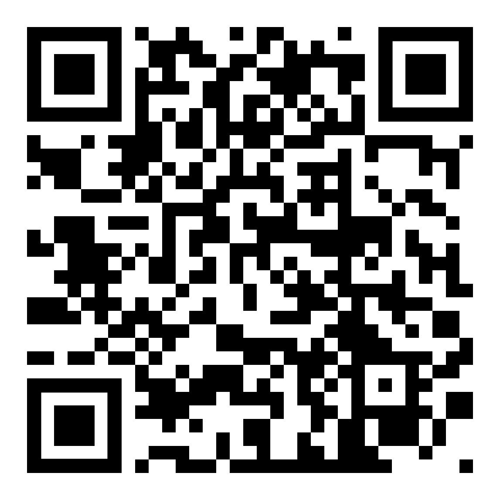

# Mess Waste Tracker
### An Object-Oriented Food Waste Monitor in C++17

## Project Overview
Mess Waste Tracker is a menu-driven C++ application designed to monitor food waste in college and hostel messes. It records prepared and wasted food for breakfast, lunch and dinner and generates useful reports.

## Features
- Add meal entries for Breakfast, Lunch and Dinner.
- View and delete meal records.
- Calculate total prepared and wasted food.
- Calculate overall and meal-wise waste percentage.
- Estimate financial loss and CO2 impact.
- Identify the meal with the highest waste.
- Generate suggestions to reduce food waste.
- Save and load records using file handling.
- Validate user inputs.

## Technologies Used
- C++17
- Object-Oriented Programming
- STL Vector
- Smart Pointers (unique_ptr)
- File Handling (fstream)
- Exception Handling

## OOP Concepts
- **Abstraction:** Abstract Meal class with pure virtual functions.
- **Encapsulation:** Private data members and public methods.
- **Inheritance:** Breakfast, Lunch and Dinner derived classes.
- **Polymorphism:** Overriding virtual functions.
- **Composition:** Mess class manages meal objects.

## Compilation and Execution

Compile using g++:

```bash
g++ -std=c++17 -Wall -Wextra mess_waste_tracker.cpp -o mess_tracker
```

Run:

```bash
./mess_tracker
```

## Sample Test Data

| Meal | Prepared (kg) | Wasted (kg) |
|---|---:|---:|
| Breakfast | 82 | 11 |
| Lunch | 178 | 22 |
| Dinner | 165 | 42 |
| **Total** | **425** | **75** |

## Expected Results
- Overall food waste: 17.6%
- Estimated financial loss: Rs 7,260
- Estimated CO2 impact: 203 kg
- Highest waste: Dinner

*The cost and CO2 values are illustrative estimates based on assumed rates.*

## Sustainable Development Goals
- **SDG 2 – Zero Hunger:** Encourages responsible food management.
- **SDG 12 – Responsible Consumption and Production:** Promotes efficient use of food and resources.

## Author
**Yogesh Kumar**

B.Tech Information Technology

## Repository
https://github.com/Yogesh131013/mess-waste-tracker

## Project QR Code

Scan the QR code below to access the project repository.




